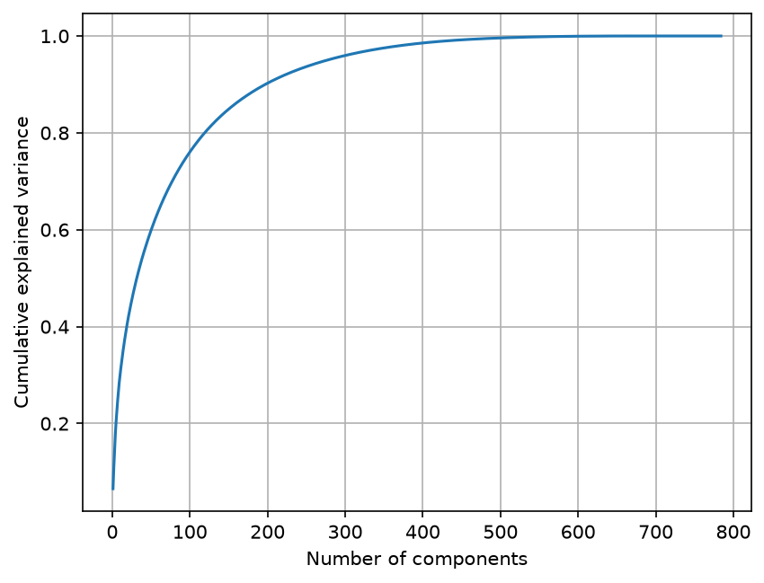
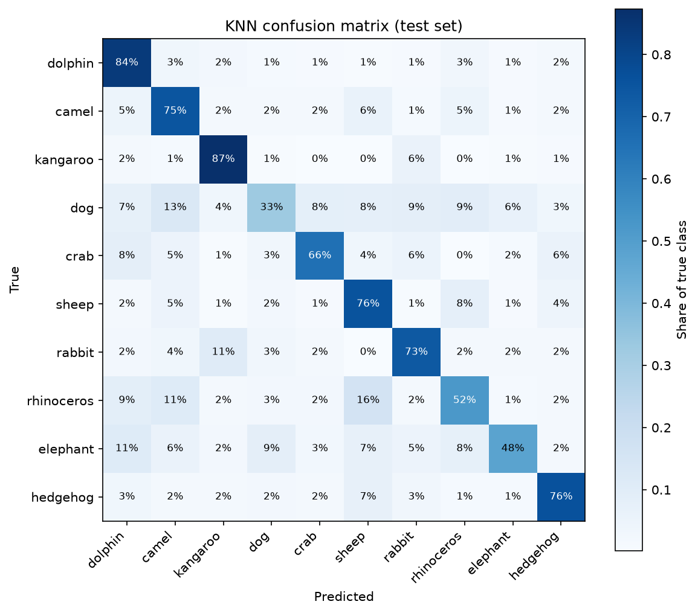

# Quick, Draw! Animal Classifier

Classification of hand-drawn animal sketches from Google's [Quick, Draw!](https://github.com/googlecreativelab/quickdraw-dataset) dataset. PCA, three classifiers and stratified k-fold cross-validation are implemented from scratch in NumPy. A drawing application classifies sketches made by the user.

The final model, PCA with 40 components followed by k-nearest neighbours (k = 20), reaches 66.9% accuracy on a held-out test set of 10 classes (chance level: 10%).

## Data

Ten classes are used: dolphin, camel, kangaroo, dog, crab, sheep, rabbit, rhinoceros, elephant and hedgehog. 3,000 drawings per class (28×28 grayscale, flattened to 784 values) are sampled at random and split 80/20 into training and test sets. The test set is used only for the final evaluation.

## Implementation

All models share a `fit(X, y)` / `predict(X)` interface.

| File | Contents |
| --- | --- |
| `src/data.py` | Memory-mapped data loading and train/test split |
| `src/pca.py` | PCA via eigendecomposition of the covariance matrix |
| `src/models.py` | Nearest Mean Classifier, LDA (shared covariance, ridge-regularized) and KNN (vectorized distances, batched prediction) |
| `src/evaluation.py` | Stratified k-fold cross-validation and confusion matrix |

PCA is fitted inside each cross-validation fold to prevent information from the validation data leaking into the features.

## Drawing application

`app.py` opens a tkinter window in which the user draws an animal. After each stroke, the sketch is cropped to its bounding box, scaled and centered to match the dataset's format, and reduced to 28×28. The three most likely classes are shown, together with the 28×28 image the model receives.

## Results



All models improve up to 20–40 components and then level off. KNN benefits most and decreases slightly at 150 components, as the additional components mainly add noise to the distances.

| Model | PCA components | 5-fold CV accuracy | Test accuracy |
| --- | --- | --- | --- |
| NMC | 80 | 49.4% ± 0.6% | 48.8% |
| LDA | 80 | 52.6% ± 0.2% | 52.7% |
| KNN (k = 20) | 40 | 66.5% ± 0.2% | 66.9% |



Per-class accuracy ranges from 87% (kangaroo) to 33% (dog). Most confusions occur among large quadrupeds, whose distinguishing features occupy only a few pixels at 28×28.

## How to use

```bash
python -m venv venv
venv\Scripts\activate            # macOS/Linux: source venv/bin/activate
pip install -r requirements.txt
python download_data.py          # downloads the data into data/
python app.py                    # starts the drawing application
```

The experiments are in `notebooks/experiments.ipynb`.

## Credits

Data: [The Quick, Draw! Dataset](https://github.com/googlecreativelab/quickdraw-dataset) by Google, licensed under [CC BY 4.0](https://creativecommons.org/licenses/by/4.0/).